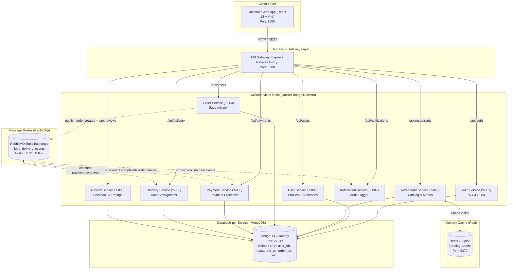

# FoodDash: Distributed Microservices Online Food Delivery System

[](#architecture-highlights)
[](#academic-course-context)
[](#docker-container-fleet)
[](#asynchronous-choreography-saga)
[](#redis-cache-aside-pattern)
[](#customer-web-application-screens-1-to-5)

> An enterprise-grade, event-driven online food delivery system engineered for campus communities. Built with **8 isolated Node.js microservices**, **RabbitMQ Saga choreography**, **Redis cache-aside pattern**, **Database-per-Service persistence on MongoDB**, and a modern **React 18 customer SPA**.

---

## Academic Course Context

* **Course**: SWE4007: Software Application Architecture
* **Institution**: Vellore Institute of Technology (VIT), Vellore
* **Faculty Evaluator**: Prof. Tauseef Khan
* **Team Members**:
  * **Aadith M Mathew** (23MIC7005)
  * **Krishnakanth** (23MIC7004)
  * **Mithran** (23MIC7008)
  * **Nihal** (23MIC7009)
  * **Harika** (23MIC7014)

---

## Architecture Highlights



1. **Database-per-Service Pattern**: Each domain microservice owns its private logical database in MongoDB (`user_db`, `restaurant_db`, `order_db`, `payment_db`, `delivery_db`, `review_db`). Direct cross-database joins are prohibited.
2. **Asynchronous Choreography Saga**: Orders coordinate distributed state using RabbitMQ topic exchange (`food_delivery_events`). Services emit domain events (`order.created`, `payment.completed`, `delivery.assigned`, `delivery.status_updated`) and react independently without distributed locking.
3. **Redis Cache-Aside Pattern**: `restaurant-service` queries Redis first (`x-cache: HIT`). On cache misses (`x-cache: MISS`), it queries MongoDB, hydrates Redis with a TTL, and invalidates cache on catalog updates.
4. **Unified API Gateway Ingress**: Single reverse proxy running at port `5000` eliminates CORS hurdles, aggregates upstream telemetry, routes traffic, and serves a live diagnostics dashboard at `/api/health`.
5. **Resilience & Fault Isolation**: Each container runs with dedicated Docker healthchecks, restart policies, and network isolation on `food-delivery-net`.

---

## Docker Container Fleet

The entire infrastructure runs as a coordinated 13-container fleet defined in [`docker-compose.yml`](docker-compose.yml):

| Service Container | Image / Build Context | Host Port | Internal Port | Architectural Responsibility |
| :--- | :--- | :---: | :---: | :--- |
| **`fooddash-frontend`** | `./frontend` | **`3000`** | `3000` | React 18 SPA customer web application (Vite dev server) |
| **`api-gateway`** | `./api-gateway` | **`5000`** | `5000` | Public ingress proxy, request routing, telemetry monitor |
| **`auth-service`** | `./services/auth-service` | **`5001`** | `5001` | JWT authentication, user registration, role authorization |
| **`user-service`** | `./services/user-service` | **`5002`** | `5002` | Customer profiles, hostel delivery addresses management |
| **`restaurant-service`** | `./services/restaurant-service` | **`5003`** | `5003` | Restaurant catalog, menus, Redis caching engine |
| **`order-service`** | `./services/order-service` | **`5004`** | `5004` | Order lifecycle state machine, Saga event initiator |
| **`payment-service`** | `./services/payment-service` | **`5005`** | `5005` | Payment processing, transaction authorization |
| **`delivery-service`** | `./services/delivery-service` | **`5006`** | `5006` | Driver assignment (Ramesh Kumar), route updates, ETA |
| **`notification-service`**| `./services/notification-service`| **`5007`** | `5007` | Event audit capture, chronological notification store |
| **`review-service`** | `./services/review-service` | **`5008`** | `5008` | Customer 5-star ratings, praise tags, review aggregation |
| **`mongodb`** | `mongo:7-jammy` | **`27017`**| `27017`| Database-per-service engine (isolated databases) |
| **`rabbitmq`** | `rabbitmq:3-management` | **`5672`**, **`15672`** | `5672`, `15672` | AMQP message broker & management dashboard UI |
| **`redis`** | `redis:7-alpine` | **`6379`** | `6379` | In-memory key-value cache layer |

---

## How to Start Everything Up

### 1. Prerequisites
* **Docker** (version 24.0 or later)
* **Docker Compose** (version 2.20 or later)
* *Optional*: Node.js 20+ (only required if running services outside Docker)

### 2. Quickstart (Single Command)

Clone the repository and launch the full 13-container stack:

```bash
# 1. Clone repository
git clone https://github.com/Codymwon/food-delivery-system-SAA.git
cd food-delivery-system-SAA

# 2. Build images and start all containers in detached mode
docker compose up --build -d
```

### 3. Verify Fleet Health

Check that all 13 containers are running and healthy:

```bash
docker compose ps
```

Probe the unified health endpoint on the API Gateway:

```bash
curl http://localhost:5000/api/health
```

Expected response (`status: UP` across all 8 microservices and infrastructure backbones):

```json
{
  "gateway": "UP",
  "status": "UP",
  "architecture": "Microservices with Database-per-Service Pattern",
  "infrastructure": {
    "mongodb": "CONNECTED",
    "rabbitmq": "CONNECTED",
    "redis": "CONNECTED"
  },
  "services": {
    "auth": "UP",
    "user": "UP",
    "restaurant": "UP",
    "order": "UP",
    "payment": "UP",
    "delivery": "UP",
    "notification": "UP",
    "review": "UP"
  }
}
```

### 4. Stopping and Restarting

```bash
# Stop all containers (preserves database volumes)
docker compose stop

# Restart stopped containers
docker compose start

# Tear down containers and bridge network
docker compose down

# Complete reset (tears down containers AND wipes database volumes for fresh seed)
docker compose down -v && docker compose up --build -d
```

---

## Live Endpoints & Port Reference

| Service / Tool | URL | Credentials / Notes |
| :--- | :--- | :--- |
| **Customer Web Application** | **`http://localhost:3000`** | Customer SPA with auto-login shortcut |
| **API Gateway Ingress** | **`http://localhost:5000`** | Root metadata and proxy index |
| **Gateway Diagnostics** | **`http://localhost:5000/api/health`** | Real-time health matrix for all services |
| **RabbitMQ Management Dashboard** | **`http://localhost:15672`** | User: `guest` · Password: `guest` |
| **MongoDB DBMS** | **`localhost:27017`** | Connection: `mongodb://localhost:27017` |
| **Redis Cache CLI** | **`localhost:6379`** | Connection: `redis://localhost:6379` |

---

## Customer Web Application (Screens 1 to 5)

The frontend is a React 18 single page application located in [`frontend/`](frontend/):

### Screen 1: Authentication & Customer Profile
* **1-Click Demo Login (Evaluator Shortcut)**: Pre-populates seeded credentials (`customer@vit.ac.in` / `password123`) and logs in under 200ms.
* **Customer Profile Slide-Over**: Shows profile details, role badge (`CUSTOMER`), and saved VIT delivery address (`Hostel Block D, Room 412, VIT Vellore`).

### Screen 2: Discovery Marketplace & Dedicated Restaurant Page
* **Cuisine Filters & Campus Picks**: Fast navigation for Burgers, Pizzas, Biryanis, Rolls, Desserts.
* **Real Campus Brands**: KFC, Burger King, Domino's, Pizza Hut, Behrouz Biryani, Subway.
* **Local Image Serving**: All food photography is bundled locally in `frontend/public/images/*.jpg` with zero external dependencies.
* **Real-time Quantity Counters**: Dish cards feature interactive `[- 1 +]` steppers and portion customization modals.

### Screen 3: Instant Checkout & Saga Order Placement
* **Hostel Delivery Address Picker**: Pre-selects default hostel address with optional delivery notes.
* **Payment Method Selector**: Segmented radio cards for UPI / Google Pay, Credit/Debit Card, and Cash on Delivery.
* **Billing Summary**: Subtotal, delivery partner fee logic (`FREE` above ₹500, else ₹30), platform & taxes fee (₹15).
* **Saga Dispatch Trigger**: "Place Order & Pay" button dispatches `POST /api/orders`, clears the cart on HTTP 201 Created, and transitions automatically to Screen 4.

### Screen 4: Live Order Tracker & Status Stepper
* **5-Stage Milestone Stepper**: Real-time progress through `PENDING` $\rightarrow$ `CONFIRMED` $\rightarrow$ `PREPARING` $\rightarrow$ `OUT_FOR_DELIVERY` $\rightarrow$ `DELIVERED`.
* **Live Polling Loop**: Automatically synchronizes status every 2.5 seconds from `GET /api/orders/:id` and `GET /api/delivery/track/:orderId`.
* **Delivery Partner Card**: Displays assigned driver **Ramesh Kumar**, rating `4.9 (840 deliveries)`, direct phone call link, and route ETA.
* **Delivered Celebration**: Displays celebratory notification and prompts customer to rate the meal.

### Screen 5: Order Reviews & Customer Feedback
* **Interactive Star Rating**: 5 hoverable stars with score labels (`1 Star - Poor` to `5 Stars - Outstanding!`).
* **Praise Tags**: Clickable tags (*"Hot & Fresh"*, *"Lightning Fast Delivery"*, *"Great Packaging"*).
* **Menu Embedded Reviews**: Submitted reviews reflect dynamically under restaurant menus on `GET /api/reviews/restaurant/:restaurantId`.

---

## Automated Scaling & Resilience Demo Script

A dedicated verification script is included in [`scripts/demo-scaling.sh`](scripts/demo-scaling.sh) for viva evaluations:

```bash
# Run the automated scaling and chaos fault-isolation demo
bash scripts/demo-scaling.sh
```

The script demonstrates:
1. Load balancing across scaled service replicas (`order-service` and `payment-service`).
2. Circuit-breaker behavior and fault isolation when a worker container is stopped.
3. Eventual consistency across RabbitMQ consumers under burst load.

---

## Repository Structure

```text
food-delivery-system-SAA/
├── docker-compose.yml              # Core 13-container fleet orchestration
├── .gitignore                      # Hardened git ignore rules
├── README.md                       # Master project overview and execution guide
├── api-gateway/                    # Reverse Proxy and Ingress Gateway (:5000)
│   ├── Dockerfile
│   ├── package.json
│   └── src/index.js
├── frontend/                       # Customer React 18 SPA (:3000)
│   ├── Dockerfile
│   ├── index.html
│   ├── package.json
│   ├── tailwind.config.js
│   ├── vite.config.js
│   ├── public/images/              # Bundled local offline food assets
│   └── src/
│       ├── api/client.js           # Central Axios gateway client with telemetry
│       ├── components/             # React screens and UI modules
│       ├── context/                # AuthContext & CartContext
│       └── index.css               # Design tokens and micro-pattern styling
├── services/                       # Isolated Domain Microservices
│   ├── auth-service/               # JWT authentication (:5001)
│   ├── user-service/               # User profiles and addresses (:5002)
│   ├── restaurant-service/         # Restaurant catalog and menus (:5003)
│   ├── order-service/              # Order lifecycle state machine (:5004)
│   ├── payment-service/            # Payment transaction processor (:5005)
│   ├── delivery-service/           # Delivery assignment engine (:5006)
│   ├── notification-service/       # Event audit logger (:5007)
│   └── review-service/             # Customer ratings and feedback (:5008)
├── scripts/                        # Evaluation and test automation
│   └── demo-scaling.sh             # Scaling and resilience demo script
└── docs/                           # Architecture blueprints and design diagrams
    ├── README.md                   # Documentation index
    ├── food_delivery_architecture_plan.md
    ├── food_delivery_architecture_diagram.png
    └── ...
```

---

## License & Attribution

Developed for academic coursework in **SWE4007: Software Application Architecture** at **Vellore Institute of Technology (VIT), Vellore**.  
All rights reserved © 2026.
