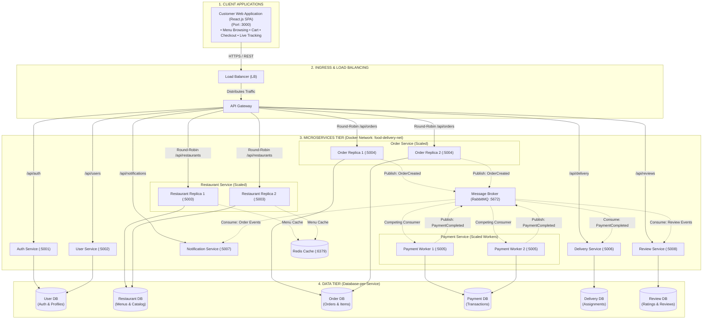

# Online Food Delivery System – Architecture Blueprint
**Course:** SWE4007 – Software Application Architecture  
**Review:** First Review (Fall Semester 2026–27)  
**Guide:** Prof. Tauseef Khan  
**Team Members:**  
- Krishnakanth (23MIC7004)
- Aadith M Mathew (23MIC7005)
- Mithran (23MIC7008)
- Nihal (23MIC7009)
- Harika (23MIC7014)

---

## 1. Project Philosophy & Review Objective
* **Goal:** This is an **architecture-first demonstration project**, designed to showcase distributed system principles, design patterns, and containerized deployment rather than a production consumer app.
* **Key Focus:** Proving that the microservices are loosely coupled, containerized, maintain strict data boundaries, and communicate resiliently.

---

## 2. Core Architectural Decisions Made

### A. Architectural Style
* **Microservices Architecture:** Decomposed into independent, single-responsibility services.
* **Separation of Traffic:**
  * **North-South (Client to Backend):** Synchronous HTTP/REST through an **API Gateway** (Port 5000). The React client talks *only* to the Gateway; internal ports are unexposed.
  * **East-West (Inter-Service):** Asynchronous **Event-Driven Architecture (EDA)** via a message broker (**RabbitMQ**), utilizing the **Choreography-based Saga pattern** for distributed workflows.

### B. Data Management: Database-per-Service Pattern
* **Decision:** Approach 2 (Dedicated Database per Microservice).
* **Rationale:** Avoids the "Distributed Monolith" anti-pattern. No microservice is allowed to query another microservice's database directly.
* **Data Consistency:** Managed via **Eventual Consistency** through events rather than distributed 2-Phase Commit (2PC) transactions.

| Service | Port | Database Name | Primary Responsibility |
| :--- | :--- | :--- | :--- |
| **Load Balancer (LB)** | `80 / 8080` | *None* | High-availability traffic ingress, SSL offloading, upstream distribution |
| **API Gateway** | `5000` | *None (Stateless)* | Reverse proxy, request routing, role authorization, rate limiting |
| **Auth Service** | `5001` | `user_db` / `auth_db` | User authentication, password hashing, JWT generation & verification |
| **User Service** | `5002` | `user_db` | Customer profiles, saved delivery addresses, role preferences |
| **Restaurant Service** | `5003` | `restaurant_db` | Restaurant discovery, cuisine filtering, menu item catalog, stock status |
| **Order Service** | `5004` | `order_db` | Cart validation, order creation, order state machine (`PENDING` $\rightarrow$ `DELIVERED`) |
| **Payment Service** | `5005` | `payment_db` | Mock transaction processing, payment status recording, receipt generation |
| **Delivery Service** | `5006` | `delivery_db` | Delivery agent assignment, geolocation/ETA tracking, delivery status |
| **Notification Service** | `5007` | *Queue Consumer* | Order alerts, status update logs, push notifications |
| **Review Service** | `5008` | `review_db` | Restaurant & delivery ratings, customer reviews, rating aggregations |
| **RabbitMQ Broker** | `5672` (UI: `15672`)| *Message Queues* | Asynchronous event transport (`OrderCreated`, `PaymentCompleted`, etc.) |
| **Redis Cache** | `6379` | *In-Memory Cache* | Fast in-memory caching for restaurant catalog & menu browsing |


---

### C. Deployment & Containerization Strategy
* **Docker & Docker Compose:** Every single service and datastore has its own `Dockerfile` and is orchestrated via a top-level `docker-compose.yml`.
* **Network Isolation:** All containers communicate over an internal Docker bridge network (`food-delivery-net`).
* **Service Discovery:** Handled via Docker's built-in DNS resolver (e.g., `http://order-service:5004` resolves without hardcoded IPs).
* **Single Command Launch:**
  ```bash
  docker compose up --build
  ```

---

### D. Horizontal Scaling & Service Replication Strategy

To satisfy SRS Section 3.4 (*"Scalability: Microservices shall allow individual services to scale independently according to workload"*), we introduce **Horizontal Pod/Container Replication** and **Load Balancing**.

#### 1. Service Replication Matrix (Which services to scale and why)

| Service | Instance Count | Scaling Pattern | Justification (SWE4007 Defense) |
| :--- | :--- | :--- | :--- |
| **`restaurant-service`** | **2 Replicas** | HTTP Round-Robin | **Read-Heavy Workload:** 90% of food app traffic is browsing menus and searching restaurants. Scaled to handle high read concurrency. |
| **`order-service`** | **2 Replicas** | HTTP Round-Robin | **Spike-Sensitive / Mission-Critical:** Peak lunch/dinner order surges. Replicas ensure zero order dropouts and zero single point of failure (SPOF). |
| **`payment-service`** | **2 Replicas** | RabbitMQ Competing Consumers | **Asynchronous Worker Pool:** Multiple payment workers listen to the same RabbitMQ queue; messages are automatically distributed across workers. |
| **`auth-service`** | 1 Instance | Singleton | Low write load. Authenticates once per session; JWT tokens are self-contained and stateless thereafter. |
| **`user-service`** | 1 Instance | Singleton | Infrequent writes (address updates, profile edits). |
| **`notification-service`**| 1 Instance | Singleton Worker | Async background logging and notifications. |
| **`api-gateway`** | 1 Instance | Ingress / Reverse Proxy | Front-door routing and HTTP load balancer for client requests. |

#### 2. Dual Load Balancing Architecture

We employ two distinct load balancing mechanisms:
1. **HTTP Load Balancing (North-South / Ingress):**
   * Handled by Docker's embedded DNS Round-Robin and the API Gateway.
   * Incoming requests to `http://order-service:5004` cycle between container instances:
     * Request 1 $\rightarrow$ `order-service_1`
     * Request 2 $\rightarrow$ `order-service_2`
2. **Message Queue Load Balancing (East-West / Async):**
   * Uses the **Competing Consumers Pattern** over RabbitMQ.
   * Both `payment-service_1` and `payment-service_2` bind to the `order.created` queue. RabbitMQ automatically round-robins event processing across available container workers.

#### 3. How to Demonstrate It Live to the Reviewer:
* Scale on demand in terminal:
  ```bash
  docker compose up --scale order-service=2 --scale restaurant-service=2
  ```
* Each replica logs its container ID (`process.env.HOSTNAME`).
* When submitting two orders in the demo UI, consecutive API responses show:
  * Request 1: `handled_by: "order-service_1 (container-id-a1b2)"`
  * Request 2: `handled_by: "order-service_2 (container-id-c3d4)"`

---

### E. Master Architecture Diagram



---

## 3. Order Lifecycle Flow (Event Choreography)


```
[ Customer ]
     │ (1) POST /api/orders (Synchronous REST)
     ▼
[ API Gateway ]
     │ Forward
     ▼
[ Order Service ] ──► Saves order (status: PENDING) in order_db
     │                 Returns 201 Created to Customer
     │
     │ (2) Publish "OrderCreated" event (Async)
     ▼
[ RabbitMQ Message Broker ]
     ├──► [ Payment Service ] ──► Charges customer ──► Emits "PaymentCompleted"
     │                                                         │
     ├──► [ Notification Service ] ──► Sends "Order Received"  │
     │                                                         ▼
     └──► [ Delivery Service ] ◄── Listens to "PaymentCompleted"
                 │
                 └──► Assigns driver ──► Emits "DeliveryAssigned"
```

---

## 4. Viva / Review Q&A Defense Strategy

| Likely Faculty Question | Recommended Architectural Answer |
| :--- | :--- |
| *"Why not share one database among all services?"* | *"Sharing a database breaks service autonomy and couples schemas. If one service changes its table schema, it risks breaking other services. Database-per-Service ensures true loose coupling."* |
| *"Why use RabbitMQ instead of calling Payment REST API directly?"* | *"Direct REST calls cause temporal coupling. If the Payment Service is slow or temporarily down, the Order Service hangs. With RabbitMQ, the event sits in the queue, providing fault tolerance and zero cascading failures."* |
| *"How did you choose which services to replicate?"* | *"We analyzed workload characteristics: Restaurant Service is read-heavy (90% of user traffic is browsing/searching menus), while Order Service is spike-sensitive during peak meal times. Scaling them horizontally ensures high throughput and availability without wasting resources on singleton services like Auth or Notification."* |
| *"How does load balancing work between your container replicas?"* | *"For synchronous HTTP calls to Order/Restaurant services, Docker's embedded DNS round-robins requests across replica IPs. For asynchronous payment processing, RabbitMQ uses the Competing Consumers pattern to distribute queue items across worker replicas."* |
| *"How does the client know when the order status changes?"* | *"Through polling the order status endpoint (`GET /api/orders/:id`) or through a WebSocket connection pushed by the Notification Service."* |
| *"What happens if a payment fails in this distributed flow?"* | *"A compensating transaction is triggered: Payment Service publishes `PaymentFailed`, and Order Service consumes it to change order status to `CANCELLED`."* |


---

## 5. Potential Additions to Consider (What We Can Add)

Review this list to decide what else to include in the project scope:

1. **Architecture Live Dashboard (High Demo Value):**
   * A dedicated page or tab on the React frontend showing real-time green/red health indicators of all 8 containers and their databases, proving the system is live and distributed.
2. **Postman API Test Collection (Required in SRS Section 3.8):**
   * A pre-configured `food_delivery.postman_collection.json` file ready to import and demo automated tests for each microservice route.
3. **Redis Caching Layer (Mentioned in SRS):**
   * Put Redis in front of the `restaurant-service` to demonstrate read-heavy caching for restaurant menus.
4. **Correlation ID (Distributed Tracing):**
   * Pass an `X-Correlation-ID` header from the API Gateway through all microservices and RabbitMQ events to trace a single request's logs across containers.
5. **Circuit Breaker Pattern:**
   * Implement a basic fallback (e.g., using `opossum` or simple timeout handling) if a downstream service stops responding.
6. **Live Chaos Demo:**
   * A review presentation trick: intentionally stop the `notification-service` container (`docker stop notification-service`) to show that order placement and payments still complete flawlessly without crashing the system.
